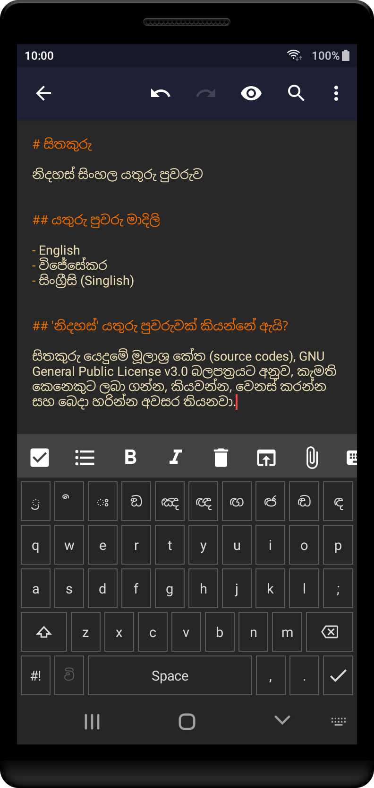
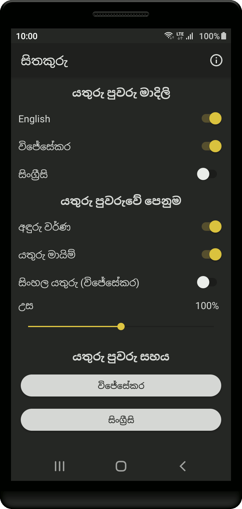
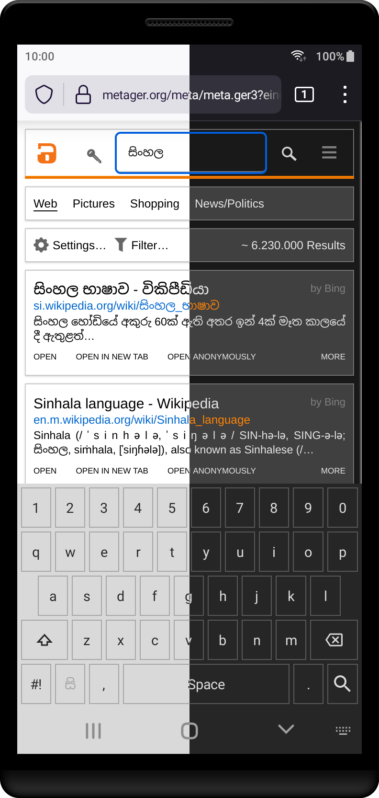

# සිතකුරු (Sithakuru - Fork with Emoji)
**නිදහස් සිංහල යතුරු පුවරුව**

> [!NOTE]
> **ව්‍යාපෘති තොරතුරු (Fork Notice):**
> මෙය [Codeberg හි සිතකුරු (Sithakuru)](https://codeberg.org/sinhala/sithakuru) නිදහස් මෘදුකාංග ව්‍යාපෘතියේ සංස්කරණයකි (fork).
> මෙහිදී යෙදුමේ සැහැල්ලු බව රැකගනිමින්, ඉමෝජි (Emoji) භාවිත කිරීමේ සහ ඇතුළත් කිරීමේ පහසුකම අලුතින් එක් කර ඇත.
>
> This repository is a fork of [Sithakuru](https://codeberg.org/sinhala/sithakuru) featuring an ultra-lightweight, native emoji picker.

ස්මාට් දුරකථන, ටැබ් ඇතුළු සියලු Android උපකරණවල සිංහල භාෂාවෙන් ලිවීම සඳහා යතුරු පුවරුවක්.

### යතුරු පුවරු මාදිළි සහ විශේෂාංග
- විජේසේකර (Wijesekara)
- සිංග්‍රීසි (Singlish)
- ඉංග්‍රීසි (English)
- **ඉමෝජි සහය (Lightweight Emoji Support)**

### පින්තූර




## English

Sithakuru is a free, open-source keyboard for typing Sinhala on Android 5.0 and newer. This fork adds a lightweight emoji picker, clipboard history and English word suggestions, all without extra libraries.

### Features
- **Layouts:** Wijesekara, Singlish (compatible with the Helakuru phonetic layout) and English
- **Emoji picker** with categories and recently used emoji
- **Clipboard history** with pinning (optional; see Privacy)
- **English word suggestions** and autocompletion
- Light, dark and custom colors, adjustable height and font size, swipe to erase or move the cursor

### Installing
Download the APK from the [Releases](../../releases) page and allow installation from your browser or file manager. Then open Sithakuru and follow the steps to enable and select the keyboard.

> [!IMPORTANT]
> This fork uses the same app ID (`sithakuru.sinhala.keyboard`) as the original Sithakuru on F-Droid, but it is signed with a different key. Android will not install one over the other: if you have the F-Droid version, uninstall it first (its settings and clipboard history are lost), and the F-Droid version will not update this one.

### Privacy
- The app has **no internet permission**; nothing you type leaves your device.
- Clipboard history is stored only on your device, as plain text in the app's private storage.
- Clips that apps mark as sensitive (for example, passwords copied from a password manager) are never saved, and nothing is saved while you type in incognito fields.
- In settings you can turn clipboard history off (this deletes what is saved), have unpinned clips deleted after an hour or a day (the default), or clear everything, pinned clips included.
- On Android 12 and older, most apps don't mark copied text as sensitive, so a copied password may be saved until it expires. Turn clipboard history off if this matters to you.

### Building
Requires JDK 17 and the Android SDK.

```sh
./gradlew assembleSithakuruDebug      # debug APK in app/build/outputs/apk/sithakuru/debug/
./gradlew testSithakuruDebugUnitTest  # unit tests
```

Release builds and signing are described in [docs/RELEASING.md](docs/RELEASING.md).

### ස්තුතිය සහ මූලාශ්‍ර (Credits)
- **මුල් සිතකුරු ව්‍යාපෘතිය (Original Sithakuru)**: <a href="https://codeberg.org/sinhala/sithakuru">codeberg.org/sinhala/sithakuru</a>
- **Simple Keyboard**<br>F-Droid - <a href="https://f-droid.org/packages/rkr.simplekeyboard.inputmethod/" rel="noopener noreferrer nofollow">f-droid.org/packages/rkr.simplekeyboard.inputmethod</a><br>Source Code - <a href="https://github.com/rkkr/simple-keyboard" rel="noopener noreferrer nofollow">github.com/rkkr/simple-keyboard</a>
- **aaaaa**<br>F-Droid - <a href="https://f-droid.org/packages/io.github.dkter.aaaaa/" rel="noopener noreferrer nofollow">f-droid.org/packages/io.github.dkter.aaaaa</a><br>Source Code - <a href="https://github.com/dkter/aaaaa" rel="noopener noreferrer nofollow">github.com/dkter/aaaaa</a>

### බලපත්‍රය (License)
GNU General Public License v3.0 only

```
Copyright (C) 2021 Kasun

This program is free software: you can redistribute it and/or modify
it under the terms of the GNU General Public License as published by
the Free Software Foundation, version 3.

This program is distributed in the hope that it will be useful,
but WITHOUT ANY WARRANTY; without even the implied warranty of
MERCHANTABILITY or FITNESS FOR A PARTICULAR PURPOSE.  See the
GNU General Public License for more details.

You should have received a copy of the GNU General Public License
along with this program.  If not, see <https://www.gnu.org/licenses/>.
```
