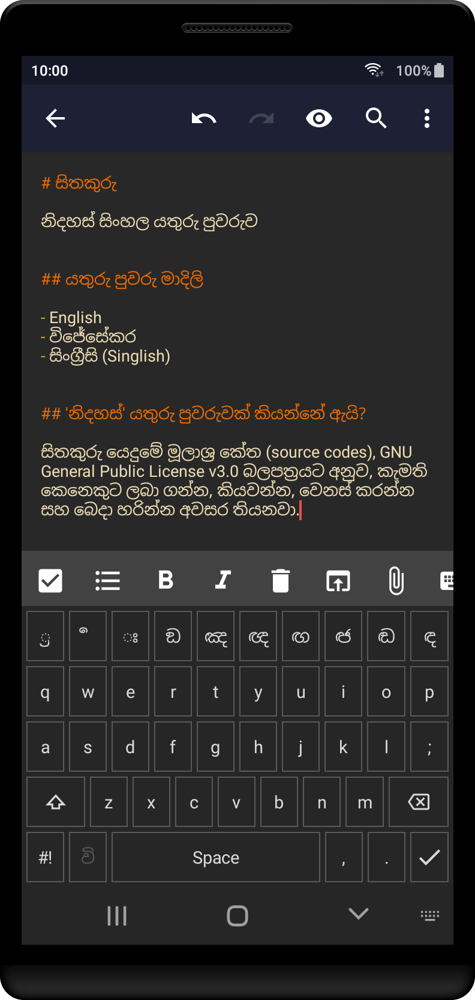
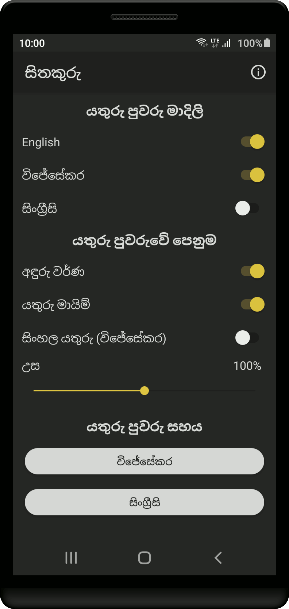
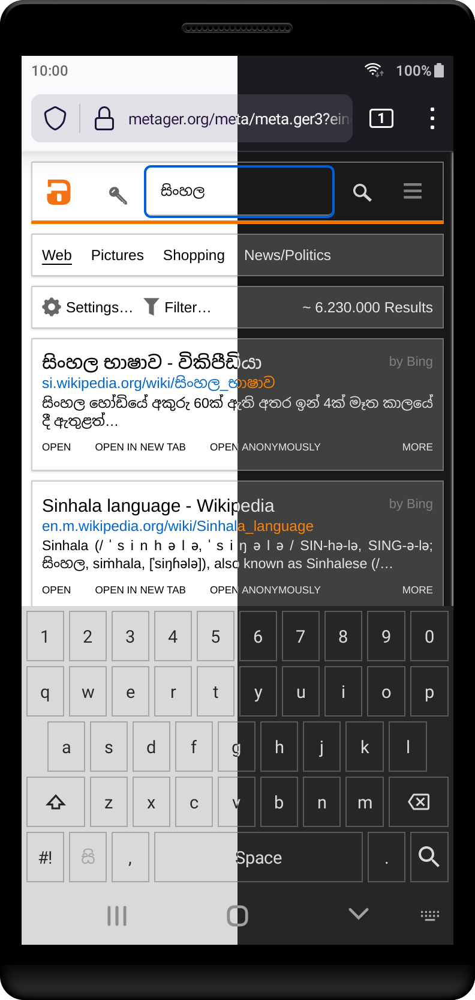

# සිතකුරු
**නිදහස් සිංහල යතුරු පුවරුව**

ස්මාට් දුරකථන, ටැබ් ඇතුළු සියලු Android උපකරණවල සිංහල භාෂාවෙන් ලිවීම සඳහා යතුරු පුවරුවක්.

### ලබාගන්න
<a href="https://f-droid.org/packages/sithakuru.sinhala.keyboard/" rel="noopener noreferrer nofollow"></a>

<a href="https://codeberg.org/sinhala/sithakuru/releases/download/2.0.0/Sithakuru_2.0.0.apk" rel="noopener noreferrer nofollow"></a>

### යතුරු පුවරු මාදිළි
- විජේසේකර
- සිංග්‍රීසි
- ඉංග්‍රීසි

### පින්තූර




### ස්තුතිය
- **Simple Keyboard**<br>F-Droid - <a href="https://f-droid.org/packages/rkr.simplekeyboard.inputmethod/" rel="noopener noreferrer nofollow">f-droid.org/packages/rkr.simplekeyboard.inputmethod</a><br>Source Code - <a href="https://github.com/rkkr/simple-keyboard" rel="noopener noreferrer nofollow">github.com/rkkr/simple-keyboard</a>

- **aaaaa**<br>F-Droid - <a href="https://f-droid.org/packages/io.github.dkter.aaaaa/" rel="noopener noreferrer nofollow">f-droid.org/packages/io.github.dkter.aaaaa</a><br>Source Code - <a href="https://github.com/dkter/aaaaa" rel="noopener noreferrer nofollow">github.com/dkter/aaaaa</a>

### බලපත්‍රය
GNU General Public License v3.0 only

```
Copyright (C) 2021 Kasun

This program is free software: you can redistribute it and/or modify
it under the terms of the GNU General Public License as published by
the Free Software Foundation, version 3.

This program is distributed in the hope that it will be useful,
but WITHOUT ANY WARRANTY; without even the implied warranty of
MERCHANTABILITY or FITNESS FOR A PARTICULAR PURPOSE.
See the GNU General Public License for more details.

You should have received a copy of the GNU General Public License
along with this program. If not, see <https://www.gnu.org/licenses/>.
```
